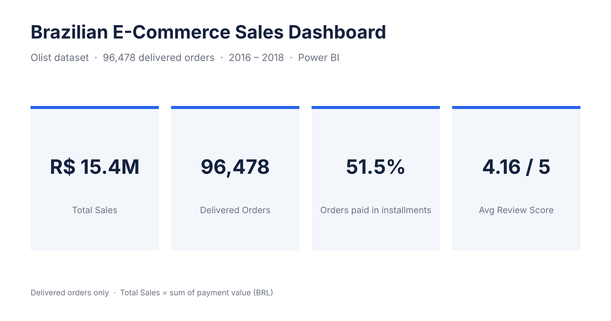
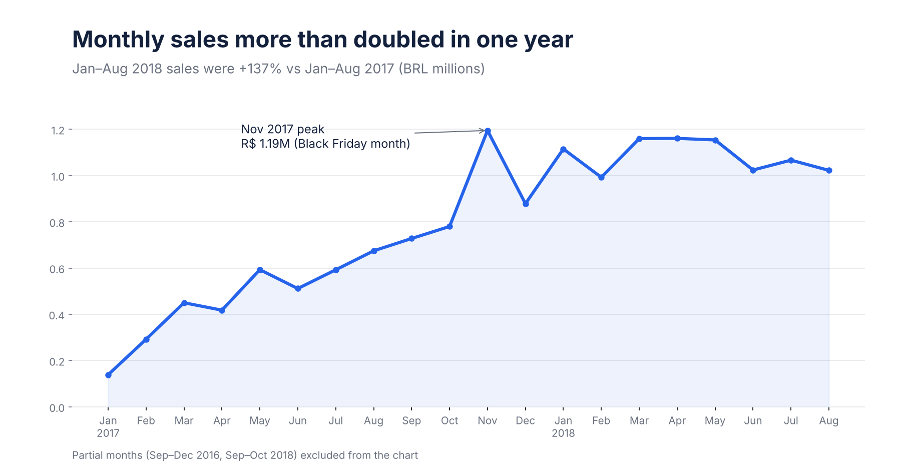
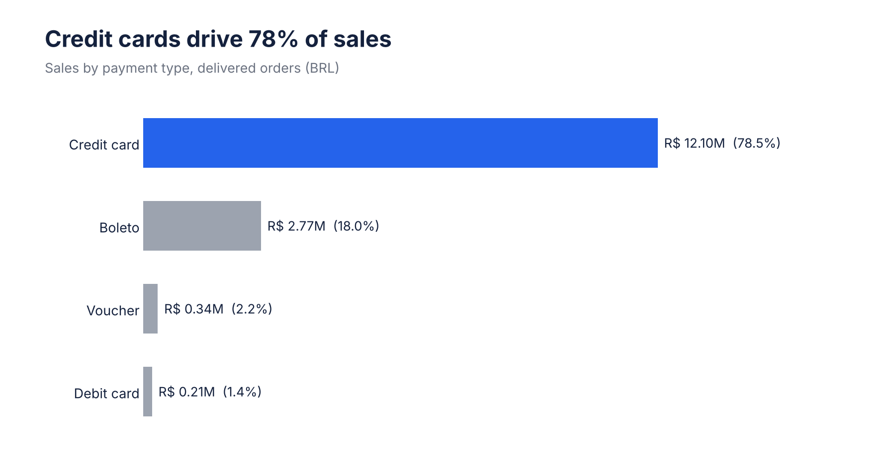

# 📊 Brazilian E-Commerce Sales Dashboard (Power BI)

An interactive Power BI dashboard built on the **Olist Brazilian E-Commerce** public dataset (96,478 delivered orders, 2016–2018), answering key business questions about sales, payments and customer satisfaction.

## ❓ Business Questions
- How did sales grow month by month?
- Which payment methods bring in the most revenue?
- What share of orders is paid in installments?
- How satisfied are customers overall?

## 🗂️ Dataset
- **Source:** [Olist Brazilian E-Commerce Public Dataset (Kaggle)](https://www.kaggle.com/datasets/olistbr/brazilian-ecommerce)
- **Tables used (9):** orders, order items, order payments, order reviews, customers, products, sellers, product category translation, and a custom **Date** table

## 🔗 Data Model
Relational model connecting the 9 tables, with a dedicated Date table for time-based analysis.

## 🧮 DAX Measures
| Measure | Description |
|---|---|
| `Total Sales` | Total revenue from orders |
| `Total Orders` | Number of orders |
| `% Installment Orders` | Share of orders paid in installments |
| `Avg Review Score` | Average customer review score (1–5) |

## 📈 Dashboard Visuals
- **KPI cards:** Total Sales, Total Orders, % Installment Orders, Avg Review Score
- **Line chart:** Monthly sales trend (Year-Month)
- **Bar chart:** Sales by payment type

## 💡 Key Insights

- **R$ 15.4M** total sales across **96,478** delivered orders
- Sales grew fast: **Jan–Aug 2018 was +143%** vs the same months of 2017
- **November 2017** was the peak month (**R$ 1.15M**, Black Friday month)
- **Credit cards** bring in **78%** of revenue (R$ 12.1M), followed by boleto (18%)
- **51.5%** of orders were paid in installments
- Average review score: **4.16 / 5**

> All figures are for **delivered** orders only.

## ▶️ How to Open
1. Download `Brazilian.E-Commerce.pbix` from the [Releases](../../releases) page
2. Open it in **Power BI Desktop** (Windows)
3. To refresh the data, download the CSVs from the [Kaggle dataset](https://www.kaggle.com/datasets/olistbr/brazilian-ecommerce) and update the file paths in Power Query

## 🛠️ Tools
Power BI Desktop · DAX · Data Modeling

## 📁 Files
| File | Description |
|---|---|
| `Brazilian.E-Commerce.pbix` | Power BI report file (download from [Releases](../../releases)) |
| `images/` | KPI and chart images |

## 👩‍💼 Author
**Falak Alghamdi**
Portfolio: [falak10.github.io](https://falak10.github.io/)
